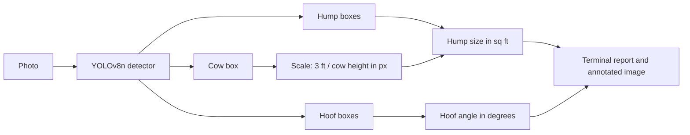

# Cow Measurement from Images

Measure a cow from a single photo.

A fine-tuned **YOLOv8** model finds the cow, its hump and its hooves in the image. **OpenCV** geometry then turns those detections into measurements — **hump size in square feet** and **hoof angle in degrees** — which are printed in the terminal and drawn onto an annotated copy of the photo.

<table>
  <tr>
    <th>Input photo</th>
    <th>Measured output</th>
  </tr>
  <tr>
    <td></td>
    <td></td>
  </tr>
</table>

Blue box: the cow, used as the size reference. Green box: the hump, with its size. Yellow: the angle measured on each detected hoof.

## Contents

- [What it measures](#what-it-measures)
- [How it works](#how-it-works)
- [Getting started](#getting-started)
- [Settings](#settings)
- [Repository layout](#repository-layout)
- [Models](#models)
- [Dataset](#dataset)
- [Training](#training)
- [Results](#results)
- [Known limitations](#known-limitations)
- [Possible improvements](#possible-improvements)
- [Video compression helper](#video-compression-helper)
- [Credits and license](#credits-and-license)

## What it measures

| Measurement | Unit | How it is obtained | Shown on the image as |
|---|---|---|---|
| Image scale | feet per pixel | Assumed cow height (`REAL_COW_HEIGHT_FT`, 3 ft by default) ÷ height of the cow's box in pixels | terminal only |
| Hump size | square feet | Width × height of the hump's box in pixels × scale² | `Hump: 0.1123 sqft` |
| Hoof angle | degrees | Taken from a rectangle fitted around the hoof's outline | `47.9 degrees` |

Every real-world size depends on the assumed cow height, so set `REAL_COW_HEIGHT_FT` to the height of the animal in the photo. See [Known limitations](#known-limitations) before relying on the numbers.

## How it works



1. **Detect.** The photo goes through a YOLOv8-nano detector fine-tuned on three classes: cow, hump and hoof. The weights store these as `0`, `1` and `Hoof`. Detections with a confidence of at least 0.1 are kept.
2. **Set the scale.** The most confident cow box becomes the size reference. The cow is assumed to be 3 ft tall, so `feet per pixel = 3 ÷ box height in pixels`.
3. **Measure the hump.** For each hump box, `size = box width × box height × (feet per pixel)²`.
4. **Measure the hooves.** Each hoof box is cropped, converted to greyscale, blurred and adaptively thresholded. The largest outline found is enclosed in a minimum-area rotated rectangle, and the angle between one side of that rectangle and its diagonal is reported (0–90°).
5. **Report.** Every detection and measurement is printed in the terminal, and an annotated copy of the photo is saved as `output/<photo name>_detected.jpg`.

Worked example, using the photo above: the cow's box is 423 px tall, so the scale is 3 ÷ 423 ≈ 0.00709 ft per pixel. The hump's box is 72 × 31 px, so its size is 72 × 31 × 0.00709² ≈ 0.112 sq ft.

## Getting started

### Requirements

- Python 3.8 or newer.
- The `ultralytics` package. Installing it also installs PyTorch, OpenCV and NumPy.
- For `movie.py` only: the `ffmpeg-python` package and the FFmpeg program on your `PATH`.

Checked with Python 3.11, Ultralytics 8.4, PyTorch 2.15 and OpenCV 4.11 and 5.0, on CPU. The bundled weights were trained with Ultralytics 8.3. No GPU is needed: a 640 × 640 photo takes about 0.15 s on a 2-core CPU.

### 1. Get the code

Clone this repository (copy its URL from the green **Code** button on GitHub) and open a terminal in its root folder. The download is about 200 MB, because the weights, the dataset and their earlier versions are all part of the repository.

### 2. Install

```bash
python -m venv .venv
source .venv/bin/activate        # Windows: .venv\Scripts\activate
pip install ultralytics
```

### 3. Set the paths

**This step is required.** The scripts still contain absolute paths from the computer they were written on (`/Users/…/COW/…`). Open the script you want to run and change the constants at the top. Paths relative to the repository root work:

```python
# work.py — measures every photo in a folder
MODEL_PATH = "fastcnn/best-2.pt"
INPUT_DIR = "fastcnn/Foot-4/test/images"    # any folder of .jpg, .jpeg or .png photos

# single — measures one photo
MODEL_PATH = "fastcnn/best-2.pt"
INPUT_IMAGE = "path/to/your/photo.jpg"
```

While you are there, set `REAL_COW_HEIGHT_FT` to the real height of the cow in your photo.

### 4. Run

From the repository root:

```bash
python single       # one photo (the file has no .py extension, but it is a Python script)
python work.py      # every photo in INPUT_DIR
```

Annotated photos are written to `output/`, and the measurements are printed in the terminal.

<details>
<summary>Terminal output for the sample photo</summary>

```text
[INFO] Processing image: fastcnn/Foot-4/train/images/20210904_122701_jpg.rf.0f1523a7ac18447c1629275b8a473d36.jpg
[DEBUG] Image loaded successfully, shape: (640, 640, 3)
[DETECTION] Model loaded successfully
[DETECTION] Model class names: {0: '0', 1: '1', 2: 'Hoof'}
[DETECTION] Found 4 detections
[DETECTION] Class ID: 0, Name: 0, Confidence: 0.95, Bbox: [96, 92, 511, 515]
[DETECTION] Class ID: 1, Name: 1, Confidence: 0.93, Bbox: [198, 114, 270, 145]
[DETECTION] Class ID: 2, Name: Hoof, Confidence: 0.16, Bbox: [243, 496, 276, 525]
[HOOF] Angle: 47.91 degrees
[DETECTION] Class ID: 2, Name: Hoof, Confidence: 0.12, Bbox: [390, 444, 422, 464]
[HOOF] Angle: 54.87 degrees
[DETECTION] Cow pixel height: 423, ft/pixel: 0.0071
[DETECTION] Selected top cow detection with confidence: 0.95
[DETECTION] PIXEL_TO_SQFT set to: 0.00005030
[DETECTION] Cow detected, feet per pixel: 0.0071 ft/pixel
[DETECTION] Hump detected, area: 0.1123 sqft
[DETECTION] Hoof detected.
✅ Output saved to: output/20210904_122701_jpg.rf.0f1523a7ac18447c1629275b8a473d36_detected.jpg
```

Two timing lines printed by Ultralytics are left out.

</details>

### If something goes wrong

| What you see | Cause | Fix |
|---|---|---|
| `FileNotFoundError: … '/Users/…'` | `INPUT_DIR` still points at the original computer. | Set the paths (step 3). |
| `[ERROR] Failed to load model`, and the saved photo has no boxes | `MODEL_PATH` is wrong. The script still saves a plain copy of the photo. | Set the paths (step 3). |
| A photo in the folder is skipped | `work.py` only reads `.jpg`, `.jpeg` and `.png` files. | Convert the photo to one of those formats. |
| The hump is labelled `Hump (0.93)` instead of a size | No cow was detected, so there is no scale. | Use a photo that shows the whole cow. |
| `ImportError: libGL.so.1` on a Linux server without a display | The standard OpenCV build needs graphics libraries. | `pip uninstall opencv-python`, then `pip install opencv-python-headless`. |

## Settings

All settings are constants at the top of each script.

| Constant | Default | Meaning |
|---|---|---|
| `MODEL_PATH` | `…/fastcnn/best-2.pt` (`best.pt` in `fastcnn/hump`) | Detector weights to load. |
| `INPUT_IMAGE` | a sample training photo | Photo to measure (`single`). |
| `INPUT_DIR` | `…/Foot-4/test/images` (`train/images` in `fastcnn/hump`) | Folder of photos to measure (`work.py`, `fastcnn/hump`). |
| `OUTPUT_DIR` | `output` | Folder for the annotated photos. It is created if missing. |
| `REAL_COW_HEIGHT_FT` | `3` | Assumed real height of the cow in feet. It sets the scale for every size. |
| `CONF_THRESHOLD` | `0.1` (`0.2` in `fastcnn/hump`) | Minimum detection confidence. In the sample above the two hooves are detected at only 0.16 and 0.12. |
| `IOU_THRESHOLD` | `0.1` | Overlap limit for removing duplicate boxes. Lower values remove more. |
| `MIN_CONTOUR_AREA` | `50` | Smallest outline, in square pixels, accepted when measuring a hoof. |

## Repository layout

```text
.
├── work.py                    Measure every photo in a folder
├── single                     Measure one photo (same measurement code, no .py extension)
├── movie.py                   Separate helper: compress a video with FFmpeg
├── fastcnn/
│   ├── best.pt                Fine-tuned detector, first training run
│   ├── best-2.pt              Fine-tuned detector, second run (used by work.py and single)
│   ├── hump                   Variant of work.py that uses best.pt
│   └── Foot-4/                Dataset: photos, labels and data.yaml
├── output/                    Example annotated result
├── runs/
│   ├── detect/cow_hump_hoof_yolov124/    Third training run: settings, results.csv, plots, weights
│   └── segment/hump-detection/           Earlier segmentation experiment: settings and label plots only
├── yolov8n.pt                 Stock YOLOv8n weights, the starting point for training
├── yolov8n-seg.pt             Stock YOLOv8n-seg weights, used by the segmentation experiment
└── .vscode/                   Editor-generated file
```

Despite the folder name `fastcnn`, no Fast R-CNN model is involved. Every model in the repository is an Ultralytics YOLOv8-nano.

## Models

| File | Size | What it is |
|---|---|---|
| `fastcnn/best-2.pt` | 6.2 MB | Fine-tuned cow / hump / hoof detector from the second run. Used by `work.py` and `single`. It reproduces the sample output above. |
| `fastcnn/best.pt` | 6.2 MB | Fine-tuned detector from the first run. Used by `fastcnn/hump`. |
| `runs/detect/cow_hump_hoof_yolov124/weights/best.pt`, `last.pt` | 18.5 MB each | Checkpoints from the third run, which was stopped before it finished. They still contain optimizer state and are not used by any script. |
| `yolov8n.pt` | 6.5 MB | Stock Ultralytics YOLOv8n trained on COCO (80 classes). |
| `yolov8n-seg.pt` | 7.1 MB | Stock Ultralytics YOLOv8n-seg trained on COCO. |

The run names contain `yolov12`, but every run started from `yolov8n.pt` and the saved networks are YOLOv8-nano. "YOLOv12" is only the text format the dataset was exported in.

## Dataset

- **Source:** the [Foot dataset, version 4](https://universe.roboflow.com/hammad-upumj/foot-fjb0f/dataset/4) on Roboflow Universe, exported in April 2025 under the CC BY 4.0 license.
- **Content:** 252 photos of humped (zebu-type) cattle, mostly taken in farm yards. They are side views of whole animals and close-ups of body parts such as hooves. Some photos are stored rotated by 90°. Going by the camera timestamps in the file names, 218 of them were taken on a single day, often seconds apart.
- **Preparation:** auto-oriented and stretched to 640 × 640. No augmentation was applied at export.
- **Classes:** `0` is the cow, `1` is the hump and `Hoof` is the hoof. Those are the names stored in `data.yaml`.
- **Label format:** each box is stored as a four-corner polygon. Ultralytics converts these to boxes when training a detector.

Number of labelled boxes, counted from the label files:

| Split | Photos | Cow | Hump | Hoof |
|---|---|---|---|---|
| train | 180 | 38 | 102 | 310 |
| valid | 39 | 14 | 17 | 59 |
| test | 33 | 6 | 20 | 69 |
| **Total** | **252** | **58** | **139** | **438** |

The labels are partial. Version 4 merges two earlier label sets, both still in the repository's history: 55 photos labelled with cow and hump, and 197 photos labelled with hooves. As a result:

- Only 58 of the 252 photos have a cow box, and only 4 have both a cow box and hoof boxes. Many of the hoof-labelled photos show a whole cow that is not labelled.
- 21 photos are in the dataset twice, once from each set and with different labels. Because of this, 9 of the 33 test photos and 3 of the 39 validation photos are also in the training split.

> **The dataset photos in the current version are out of sync with their labels.** The label files are complete, but:
>
> - `valid/images` and `test/images` each hold copies of 171 photos from `train/images` instead of the original validation and test photos. None of them match the label files beside them, so results on `test/images` are not an independent test.
> - `train/images` holds 168 of the 180 labelled training photos, plus 6 extra photos that have no labels and are not part of the Roboflow dataset or its license.
>
> This does not affect measuring photos. For training or evaluation, use the complete dataset, in which every photo has its label file. It is preserved in this repository's history at commit `d29e500`, and the Roboflow page above is its original source. With a full `git clone` (not a ZIP download), this checks that commit out into a folder next to the repository:
>
> ```bash
> git worktree add ../foot4-original d29e500
> ```
>
> The complete dataset is then at `../foot4-original/fastcnn/Foot-4/`.

<details>
<summary>Label statistics plot from training</summary>


</details>

## Training

The training script is not part of the repository. The two detectors the scripts use were trained outside it: the dataset path stored in them is `/content/Foot-4/data.yaml`, which suggests a Google Colab notebook. The settings below were read back from the metadata stored inside the weight files and from the saved run configuration (`runs/detect/cow_hump_hoof_yolov124/args.yaml`).

| Setting | Value |
|---|---|
| Starting weights | `yolov8n.pt` (COCO-pretrained) |
| Image size | 640 |
| Batch size | 2 |
| Early-stopping patience | 20 |
| Optimizer | `auto` |
| Augmentation | Ultralytics defaults, plus `mixup=0.1` and `copy_paste=0.1` |
| Seed | 0 |
| Ultralytics version | 8.3.112 and 8.3.113 |

The current version of the repository holds the results of three runs with these settings:

| Run | Weights kept as | Device | Epochs completed | Best epoch | Validation mAP50 at best epoch |
|---|---|---|---|---|---|
| `cow_hump_hoof_yolov12` | `fastcnn/best.pt` | CPU | 35 of 50, stopped early | 15 | 0.83 |
| `cow_hump_hoof_yolov123` | `fastcnn/best-2.pt` | CPU | 20 of 20 | 19 | 0.80 |
| `cow_hump_hoof_yolov124` | `runs/detect/cow_hump_hoof_yolov124/weights/` | Apple MPS | 13 of 20, stopped | 3 | 0.66 |

The third run got worse after epoch 3 (validation mAP50 fell from 0.66 to 0.24 by epoch 13) and was not completed. An earlier run on Apple MPS, kept in the repository's history at commit `d29e500`, degraded in the same way (0.68 at epoch 3, 0.15 at epoch 8), while both CPU runs trained normally. The cause was not investigated. If you see the same thing on a Mac, try adding `device=cpu` to the command below.

To train again with the same settings, get the complete dataset first (see [Dataset](#dataset)), then run this from the repository root:

```bash
yolo detect train model=yolov8n.pt data=../foot4-original/fastcnn/Foot-4/data.yaml epochs=50 patience=20 batch=2 imgsz=640 mixup=0.1 copy_paste=0.1
```

Ultralytics prints where it saved the result, normally `runs/detect/train/weights/best.pt`. Point `MODEL_PATH` at that file to use it.

## Results

Detection scores for the two detectors the scripts use, computed with Ultralytics 8.4 on the complete dataset from commit `d29e500`:

| Weights | Split | Photos | Precision | Recall | mAP50 | mAP50-95 |
|---|---|---|---|---|---|---|
| `fastcnn/best.pt` | valid | 39 | 0.83 | 0.73 | 0.83 | 0.57 |
| `fastcnn/best.pt` | test | 33 | 0.63 | 0.77 | 0.62 | 0.36 |
| `fastcnn/best-2.pt` | valid | 39 | 0.83 | 0.67 | 0.79 | 0.56 |
| `fastcnn/best-2.pt` | test | 33 | 0.74 | 0.72 | 0.61 | 0.36 |

AP50 for each class:

| Weights | Split | Cow | Hump | Hoof |
|---|---|---|---|---|
| `fastcnn/best.pt` | valid | 0.91 | 0.98 | 0.60 |
| `fastcnn/best.pt` | test | 0.30 | 0.92 | 0.63 |
| `fastcnn/best-2.pt` | valid | 0.83 | 0.97 | 0.59 |
| `fastcnn/best-2.pt` | test | 0.33 | 0.95 | 0.56 |

How to read these numbers:

- They describe how well objects are **detected**, not how accurate the **measurements** are.
- **They are not scores on unseen cattle.** The validation split was used to choose the best epoch. The test split is not independent either: 9 of its 33 photos are also in the training split under different labels, and every one of them was taken within 7 seconds of a training photo. The scores say little about other animals, places or cameras.
- Both splits are small, so differences of a few points are not meaningful.
- The validation rows closely match the scores recorded during training (mAP50 of 0.83 and 0.80).
- **Hump** detection is strong on both splits.
- **Hoof** is the weakest class. Hoof detections tend to have low confidence: at the confidence level Ultralytics picks for reporting precision and recall, only 20–39 % of the labelled hooves are found. The scripts' low `CONF_THRESHOLD` of 0.1 keeps more of them.
- The low **cow** score on the test split mostly reflects missing labels, not missed cows. `best-2.pt` found all 6 labelled cows, and in 14 other test photos it boxed a clearly visible cow that has no cow label.

To reproduce a row, get the complete dataset (see [Dataset](#dataset)) and run this from the repository root:

```bash
yolo detect val model=fastcnn/best-2.pt data=../foot4-original/fastcnn/Foot-4/data.yaml split=test
```

## Known limitations

- **The scale is an assumption.** Every real-world size comes from one constant: the cow is taken to be `REAL_COW_HEIGHT_FT` (3 ft) tall, measured as the vertical extent of its box. Set the constant to the animal's real height and use upright photos. In a photo rotated by 90°, the box height is the animal's length.
- **A whole cow has to be detected.** Without a cow box there is no scale, and `single` labels the hump with its confidence instead of a size. `work.py` and `fastcnn/hump` do not clear the scale between photos, so in that situation they reuse the scale of an earlier photo and the printed hump size is not meaningful. Check the log for `Cow not detected` on that photo.
- **Hump size is the area of the hump's box,** which is larger than the hump's real outline.
- **The hoof angle is experimental.** It is derived from the proportions of a rectangle fitted to a thresholded outline, so it is sensitive to lighting and background. The same hoof shape can be reported as an angle or as its complement (for example about 27° or about 63°), depending on which way it leans in the photo and on the OpenCV version.
- **One uncalibrated photo.** Camera distance, lens, viewing angle and the animal's pose all change the pixel sizes the measurements are based on.
- **Small, narrow dataset.** The dataset is 252 photos (231 distinct), 218 of them from a single day, and most are labelled for only some of the three classes. There are no test results for other breeds, places or cameras.
- **Measurement accuracy has not been quantified.** The repository contains no hand-measured reference values to compare against.

## Possible improvements

- Take the photo, the weights and the cow's height as command-line arguments instead of constants in the scripts.
- Clear the scale for every photo, and load the model once per run instead of once per photo.
- Calibrate with a known reference, such as a measured height per animal or a marker in the scene.
- Measure the hump from a segmentation mask instead of a box.
- Define the hoof angle against the ground line and check it against manual measurements.
- Restore the complete dataset photos from commit `d29e500`. Then label the cow, hump and hooves in every photo that shows them, remove the 21 duplicate photos, and give the classes readable names.
- Add photos of more animals in more places, and split the data by photo session so that near-identical shots do not end up in both the training and the test set.
- Save the measurements to a CSV or JSON file.

## Video compression helper

`movie.py` is separate from the measurement code. It compresses a video to H.264 video and AAC audio at 1280 × 720 and about 1000 kbps, then prints the file size before and after.

```bash
pip install ffmpeg-python      # the FFmpeg program must also be installed
python movie.py
```

The input path is set at the bottom of the file (`input_video`) and points at a file on the original computer, so change it first. The result is written to `compressed_video.mp4`.

## Credits and license

- Built by Hammad Safi ([@HammadBullah](https://github.com/HammadBullah)).
- Detection uses [Ultralytics YOLOv8](https://github.com/ultralytics/ultralytics). The library and its pretrained weights are licensed under AGPL-3.0.
- The dataset is hosted on, and was exported from, [Roboflow](https://roboflow.com). It is licensed under CC BY 4.0.
- Image processing uses [OpenCV](https://opencv.org).

This repository does not include a license file yet.
